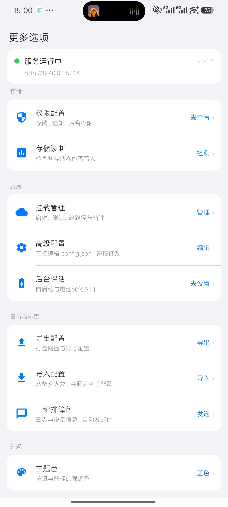
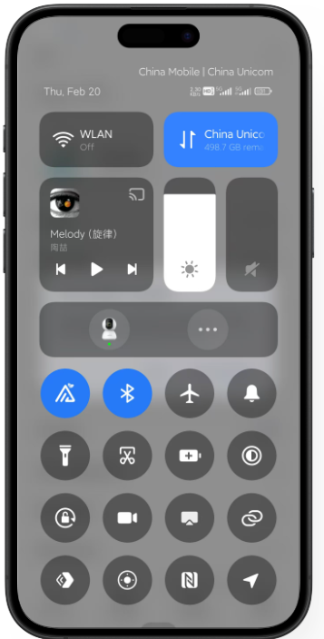
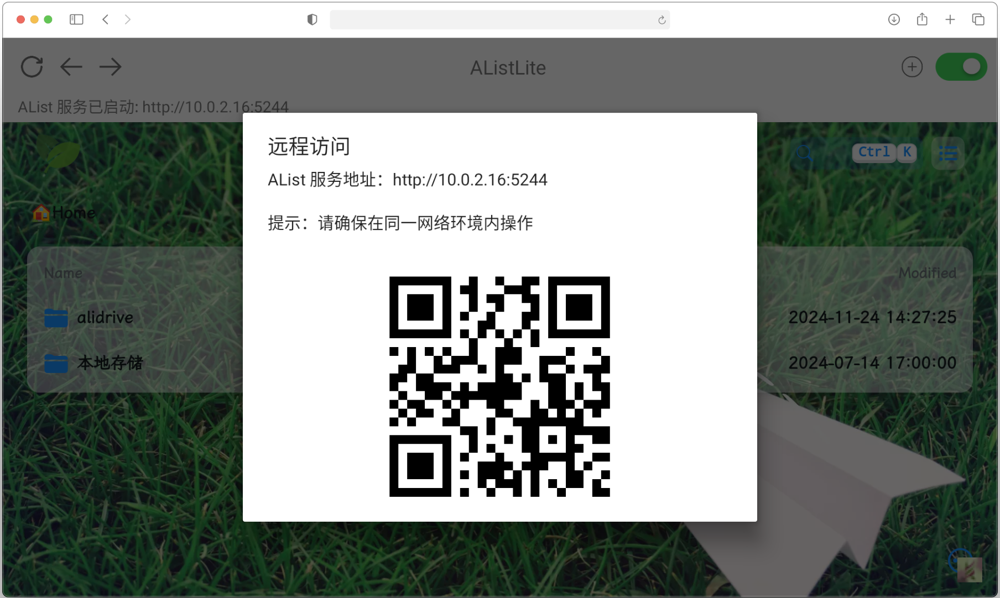
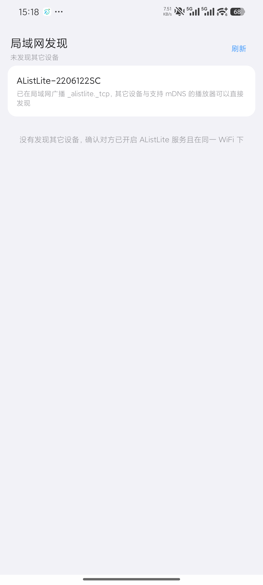
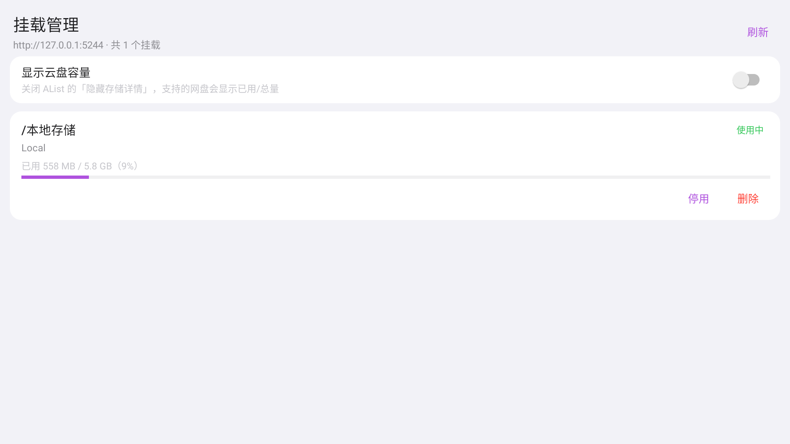
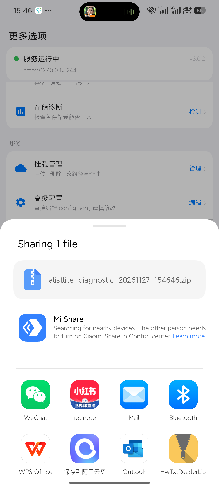

<p align="center"><a href="https://github.com/LeoHaoVIP/AListLiteAndroid" target="_blank" rel="noopener noreferrer"></a></p>
    <h3 align="center">AListLite | 在 Android 上一键启动 OpenList 服务</h3>
<h5 align="center">服务一键启停、状态栏磁贴、后台常驻、开机自启、挂载管理、局域网发现，界面简洁，上手简单。</h5>
<p align="center">
    <a href="https://github.com/LeoHaoVIP/AListLiteAndroid/releases" style="color: white" target="_blank"
       rel="noopener noreferrer">
        
    </a>
    
    
</p>
<p align="center">
    <a href="https://alist.nn.ci/zh/guide/drivers/common.html" style="color: white" target="_blank"
       rel="noopener noreferrer">
        
    </a>
    <a href="https://github.com/LeoHaoVIP/AListLiteAndroid/issues" style="color: white" target="_blank"
       rel="noopener noreferrer">
        
    </a>
    <a href="mailto:zhaowenhao2867@outlook.com" style="color: white" target="_blank"
       rel="noopener noreferrer">
        
    </a>
</p>


# AListLite

[AListLite](https://github.com/LeoHaoVIP/AListLiteAndroid) 是一款支持运行 [AList](https://alistgo.com/zh/) 服务（现已迁移到 [OpenList](https://oplist.org/zh/)）的 Android 应用，相对于教程 [BV1ex4y157xJ](https://www.bilibili.com/video/BV1ex4y157xJ) 中的描述，用户无需借助安装 Termux 即可实现在 Android 设备（手机/电视）上使用 AList 服务。

服务端以 Go 编译为原生库直接运行在 App 内，因此不需要 root、不需要 Termux、不占用额外端口做转发，装上就能用。

<p align="center"></p>
<h5 align="center">Buy Me a Coffee!</h5>

## 功能一览

| 分类 | 能力 |
| ---- | ---- |
| 服务 | 一键启停、状态栏磁贴、后台常驻、开机自启、通知栏显示访问地址 |
| 管理 | 挂载管理（App 内启停/删除/改路径与备注）、存储空间卡片、高级配置（直接改 config.json） |
| 访问 | 远程访问二维码、浏览器访问、局域网发现（mDNS 自动发现同网段设备） |
| 数据 | 配置导出/导入（zip 备份）、管理员密码修改 |
| 诊断 | 存储诊断（逐卷实测可写）、一键排障包（日志+设备信息，脱敏后直接发邮件） |
| 个性化 | 6 种主题色、深浅色自适应、TV 遥控器适配 |
| 网络 | 切换网络自动恢复服务与页面，不打断当前浏览位置 |

## Compatibility

[AListLite](https://github.com/LeoHaoVIP/AListLiteAndroid) 集成了 Golang 实现的 [OpenList](https://github.com/OpenListTeam/OpenList)，适配 `x86_64`、`x86`、`arm64-v8a`、`armeabi-v7a` CPU 架构，可运行在主流 Android 版本上（最低支持 Android 5.0 版本 | SDK API 21），同时适配移动设备和 TV 设备。

<center class="half">

</center>

## User Manual

### 安装

| 发布平台 | 发布地址                                                     | 备注         |
| -------- | ------------------------------------------------------------ | ------------ |
| GitHub   | https://github.com/LeoHaoVIP/AListLiteAndroid/releases/latest |              |
| Gitee    | https://gitee.com/leohaovip/AListLiteAndroid/releases/latest |              |
| 镜像加速 | https://gh-proxy.com/https://github.com/LeoHaoVIP/AListLiteAndroid/releases | gh-proxy 代理，国内访问更快 |

> 安装包按 CPU 架构分包（`arm64-v8a` / `armeabi-v7a` / `x86` / `x86_64`）另有 `universal` 通用包，拿不准架构就下载通用包。

### 启动服务

> ① 服务启动完成后，建议在 PC 端访问服务地址进行后续的 AList 配置
>
> ② 设备本地请访问 http://localhost:5244

点击右上角开关，开启或停止 AList 服务，服务启动成功后将显示 AList 前端页面。

<center class="half">

</center>

### 授予权限

> **开机自启说明**
>
> 若要实现 AList 服务开机自启，授予相关权限后，还需要在系统设置中手动开启 APP 的自启动开关。

首次打开 APP 后，软件将申请必要的存储、通知与后台运行权限，权限授予情况可点击软件右上角 `+` 号，进入 `更多选项` → `权限配置` 页面查看。

<center class="half">

</center>

### 菜单结构

右上角 `+` 号（电视端按遥控器 `菜单` 键）打开功能面板，常用功能放在一级菜单，低频设置收进 `更多选项`：

| 分组 | 项目 |
| ---- | ---- |
| 服务 | 远程访问、浏览器访问、服务日志 |
| 安全 | 一键登录、密码设置、HTTPS 设置 |
| 更多 | 阿里云盘令牌、更多选项、检查更新、关于 AListLite |

`更多选项` 内按四组排布：存储（权限配置、存储诊断）、服务（挂载管理、高级配置、后台保活、局域网发现）、备份与排查（导出配置、导入配置、一键排障包）、外观（主题色）。

<center class="half">

</center>

### 修改管理员密码

点击右上角 `+` 号，选择 `密码设置` 可修改管理员密码，默认登录信息为 `admin` / `123456`。

> 在网页端改过密码后，App 侧的「一键登录」会失效，重新在 `密码设置` 里填写新密码即可。

<center class="half">

</center>

### 状态栏磁贴

Android N（7.0）及以上版本可在控制栏设置 AListLite 快速启停磁贴，实现无需打开软件，即可快速开启或关闭 AList 服务。

<center class="half">

</center>

### 远程访问

点击右上角 `+` 号，选择 `远程访问` 可调出远程访问二维码，便于 TV 端用户在移动设备上完成配置操作。

<center class="half">

</center>

> 二维码生成失败时会给出「复制地址」按钮，直接把地址粘贴到目标设备浏览器即可。

### 局域网发现

服务启动后会自动通过 mDNS 在局域网内广播自己（服务名 `AListLite-<机型>`），同时注册标准类型 `_http._tcp`，因此 Windows Bonjour、VLC、Infuse 等支持 Bonjour 的播放器也能自动发现。

`更多选项` → `服务` → `局域网发现` 可以：

- 查看本机广播名称
- 搜索同网段内其它 AListLite / OpenList 设备，5 秒搜索窗口，省电
- 点条目直接用浏览器打开，或复制地址

<center class="half">

</center>

> 只在同一广播域内有效：跨网段、VLAN、路由器开了「AP 隔离/访客网络」都会搜不到。

## 挂载管理

不用进网页，直接在 App 里管理云盘挂载，电视端用遥控器也能操作：启停、删除、修改挂载路径与备注。页面顶部可切换「显示云盘容量」，开启后支持的网盘会显示已用/总量进度条。

<center class="half">

</center>

> 部分驱动（如 189CloudPC、AliyundriveOpen）本身不提供容量接口，即使开关打开也不会显示进度条，这是网盘驱动的限制。

## 备份与恢复

`更多选项` → `备份与排查`：

- **导出配置**：把网盘挂载与账号配置打包成 zip，支持指定目录，也可用「兼容模式」直接写入系统下载目录
- **导入配置**：从备份文件恢复，会覆盖当前配置

导入后会提示具体文件名，便于确认导入的是哪一份备份。

## 一键排障包

反馈问题时不用再手抄设备信息。`更多选项` → `备份与排查` → `一键排障包` 会收集：

| 文件 | 内容 |
| ---- | ---- |
| `info.txt` | 版本、机型、系统版本、ABI、WebView 版本、服务状态与端口、网卡地址、挂载摘要、权限状态 |
| `config.json` / `settings.json` | OpenList 配置与设置（密码、token、secret 等已脱敏为 `***`） |
| `app-log.txt` | App 侧最近 800 条日志 |
| `app-crash.txt` | 最近一次崩溃的完整堆栈（含崩溃前日志） |
| `alist.log` | OpenList 服务端日志 |

打包完成后直接调起系统分享面板，选择邮件应用即可发送，收件人、主题、正文与附件都会自动填好。

<center class="half">

</center>

## 外观

`更多选项` → `外观` → `主题色` 提供 6 种强调色（蓝、紫、绿、橙、粉、青），立即生效，界面跟随系统的深色模式自动适配。

## Update

对于已安装 APP 的用户，软件每次开启时将自动检查更新。用户也可点击右上角 `+` 号，选择下方 `检查更新` 手动获取新版本发布情况。

<center class="half">

</center>

## Advanced

为最大程度匹配 AList 本身的能力，AListLite 允许用户手动修改 AList 配置文件。用户可点击右上角 `+` 号，选择 `更多选项` → `高级配置` 进入配置文件修改页面，实现自定义端口、HTTPS 设置、数据库配置等个性化需求。

> 注意：错误的配置可能导致服务无法启动，请谨慎操作！

<center class="half">

</center>

## 自行编译

环境要求：

- JDK 8（本地使用 AGP 4.2.2；CI 使用 JDK 17）
- Android SDK，`compileSdk 34` / `minSdk 21`
- 编译内嵌 OpenList 需要 Go 与 gomobile，见 `AListLib/scripts/install_gomobile.sh`

```bash
# 只编译 App（使用已生成的 libgojni.so）
./gradlew :app:assembleDebug

# 产物
app/build/outputs/apk/debug/AListLite-v*-{arm64-v8a,armeabi-v7a,x86,x86_64,universal}-debug.apk
```

> Bugly AppID 通过 `AndroidManifest.xml` 的 `${BUGLY_APPID}` 占位符注入，真实值放在本地 `bugly.properties`（已在 `.gitignore` 中），请勿提交。

## 常见问题

**打开后页面空白？**
先确认服务是否已启动（右上角开关为绿色）。若服务正常但页面空白，多为系统 WebView 版本过低，可在应用商店更新「Android System WebView」。

**电视上装完闪退？**
优先确认系统 WebView 是否存在并可更新；同时把机型与症状反馈到 Issues，排障包里会带上崩溃堆栈。

**OTG/SD 卡挂载后只读？**
需要授予「所有文件访问权限」（`更多选项` → `权限配置`），部分 ROM 还需在系统设置里额外授权。

**二维码显示不出来？**
少数 ROM 的字符集实现异常会导致二维码库报错，App 已做降级处理；仍失败时可点「复制地址」手动访问。

**切换 WiFi 后地址变了怎么办？**
无需操作，App 会自动侦测地址变化并重启服务、刷新页面，且保留当前浏览的目录。

# Support

Email: <zhaowenhao2867@outlook.com>

Bilibili: [AListLite | 一款支持运行 AList 服务的 Android 应用](https://www.bilibili.com/video/BV1PA4m1G7Ui)
