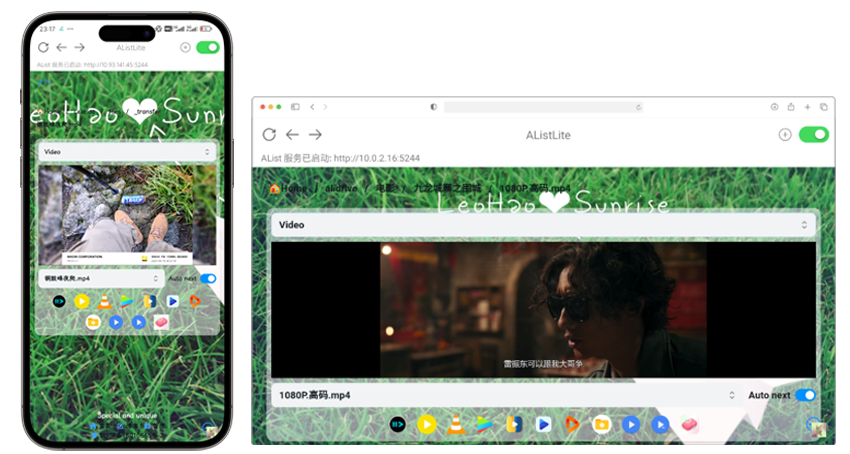
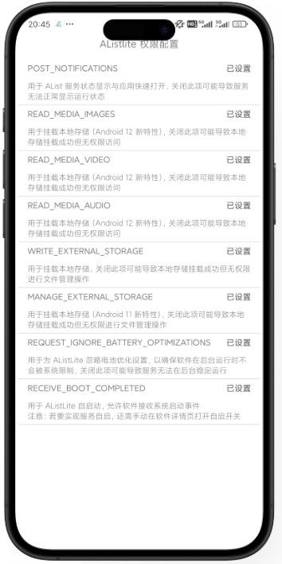
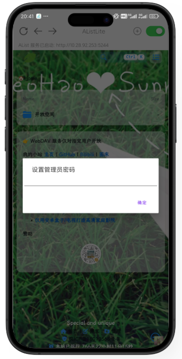
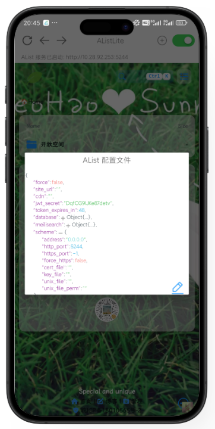
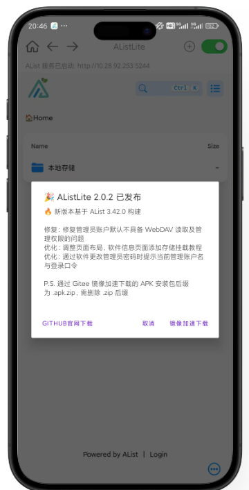

<p align="center"><a href="https://github.com/LeoHaoVIP/AListLiteAndroid" target="_blank" rel="noopener noreferrer"></a></p>
<h3 align="center">AListLite | 在 Android 上一键启动 OpenList 服务</h3>
<h5 align="center">服务启停 · 状态栏磁贴 · 后台常驻 · 开机自启 · 挂载管理 · 局域网发现</h5>
<p align="center"><a href="https://github.com/LeoHaoVIP/AListLiteAndroid/releases" target="_blank" rel="noopener noreferrer"></a>&nbsp;&nbsp;&nbsp;</p>
<p align="center"><a href="https://alist.nn.ci/zh/guide/drivers/common.html" target="_blank" rel="noopener noreferrer"></a>&nbsp;<a href="https://github.com/LeoHaoVIP/AListLiteAndroid/issues" target="_blank" rel="noopener noreferrer"></a>&nbsp;<a href="mailto:zhaowenhao2867@outlook.com" target="_blank" rel="noopener noreferrer"></a></p>

[AListLite](https://github.com/LeoHaoVIP/AListLiteAndroid) 是 [AList](https://alistgo.com/zh/)（现 [OpenList](https://oplist.org/zh/)）服务的 Android 宿主应用。相比教程 [BV1ex4y157xJ](https://www.bilibili.com/video/BV1ex4y157xJ) 的 Termux 方案，无需终端环境即可在手机与电视上运行同一套服务。服务端以 Go 编译为原生库，随应用进程启动，不依赖 root。

<p align="center"></p>
<h5 align="center">☕ Buy Me a Coffee!</h5>

## ✨ 功能

| | 分类 | 能力 |
| :--: | ---- | ---- |
| 🚀 | 服务 | 一键启停、状态栏磁贴、后台常驻、开机自启、通知栏显示访问地址 |
| 🗂 | 管理 | 挂载管理（启停 / 删除 / 改路径与备注）、存储容量、高级配置 |
| 🌐 | 访问 | 远程访问二维码、浏览器访问、局域网发现（mDNS） |
| 🩺 | 诊断 | 存储诊断、一键排障包（脱敏后分享）、配置导出与导入 |
| 🎨 | 个性化 | 6 种主题色、深浅色自适应、TV 遥控器适配 |

## 📦 安装与要求

支持 `arm64-v8a`、`armeabi-v7a`、`x86_64`、`x86`，最低 Android 5.0（API 21），适配手机与 TV。

| 渠道 | 地址 |
| :--: | ---- |
| 🐙 GitHub | https://github.com/LeoHaoVIP/AListLiteAndroid/releases/latest |
| 🧧 Gitee | https://gitee.com/leohaovip/AListLiteAndroid/releases/latest |
| 🚀 镜像加速 | https://gh-proxy.com/https://github.com/LeoHaoVIP/AListLiteAndroid/releases |

> 💡 安装包按架构分包，另提供 `universal` 通用包。

<center class="half">

</center>

## 🚀 使用

### 启动服务

点击右上角开关启停服务，启动成功后显示 OpenList 前端页面。设备本地访问 `http://localhost:5244`，首次配置建议在 PC 端访问通知栏显示的服务地址。

<center class="half">

</center>

### 授予权限

首次启动会申请存储、通知与后台运行权限，授权情况可在 `更多选项` → `权限配置` 查看。

> ⚠️ 开机自启除授权外，还需在系统设置中开启应用自启动开关。

<center class="half">

</center>

### 菜单结构

右上角 `+` 打开功能面板，TV 端按遥控器 `菜单` 键。

| 分组 | 项目 |
| ---- | ---- |
| 🚀 服务 | 远程访问、浏览器访问、服务日志 |
| 🔐 安全 | 一键登录、密码设置、HTTPS 设置 |
| ⋯ 更多 | 阿里云盘令牌、更多选项、检查更新、关于 AListLite |

`更多选项`：存储（权限配置、存储诊断）、服务（挂载管理、高级配置、后台保活、局域网发现）、备份与排查（导出配置、导入配置、一键排障包）、外观（主题色）。

### 管理员密码

`+` → `密码设置`。默认登录信息为 `admin` / `123456`。

> ⚠️ 在网页端修改密码后，App 端「一键登录」失效，需在 `密码设置` 中重新填写。

<center class="half">

</center>

### 状态栏磁贴

Android 7.0（API 24）及以上可在快捷设置中添加磁贴，无需进入应用即可启停服务。

<center class="half">

</center>

### 远程访问

`+` → `远程访问` 显示服务访问二维码，便于在 TV 端由移动设备完成配置。

<center class="half">

</center>

> 💡 少数 ROM 的字符集实现异常会导致二维码生成失败，此时使用「复制地址」直接粘贴访问。

## 📡 局域网发现

服务启动后通过 mDNS 在局域网广播，服务名 `AListLite-<机型>`，同时注册标准类型 `_http._tcp`，Windows Bonjour、VLC、Infuse 等客户端可自动发现。

`更多选项` → `服务` → `局域网发现` 可查看本机广播状态，并列出同网段内其它 AListLite / OpenList 设备（搜索窗口 5 秒），条目可直接浏览器打开或复制地址。

> ⚠️ 仅在同一广播域内有效。跨网段、VLAN，或路由器开启 AP 隔离 / 访客网络时无法发现。

## 🗂 挂载管理

无需进入网页，可在应用内完成挂载的启停、删除，以及挂载路径与备注修改；TV 端可用遥控器操作。页面顶部「显示云盘容量」开启后，支持的网盘显示已用 / 总量进度条。

> 💡 189CloudPC、AliyundriveOpen 等驱动未实现容量接口，开启开关亦不显示进度条。

## 🩺 排障与备份

`更多选项` → `备份与排查`：

| 功能 | 说明 |
| ---- | ---- |
| 📤 导出配置 | 将挂载与账号配置打包为 zip，可指定目录，或以「兼容模式」写入系统下载目录 |
| 📥 导入配置 | 从备份恢复，覆盖当前配置；完成后显示所导入文件的文件名 |
| 🩺 一键排障包 | 收集设备与日志信息，脱敏后调起分享面板，收件人、主题、正文与附件已预填 |

排障包内容：

| 文件 | 内容 |
| ---- | ---- |
| `info.txt` | 版本、机型、系统与 SDK、ABI、WebView 版本、服务状态与端口、网卡地址、挂载摘要、权限状态 |
| `config.json`<br>`settings.json` | OpenList 配置与设置，密码、token、secret 等字段替换为 `***` |
| `app-log.txt` | 应用侧最近 800 条日志 |
| `app-crash.txt` | 最近一次未捕获异常的完整堆栈及崩溃前日志 |
| `alist.log` | OpenList 服务端日志 |

## ⚙️ 高级配置

`+` → `更多选项` → `高级配置` 可直接编辑 AList 配置文件，用于自定义端口、HTTPS、数据库等参数。

> ⚠️ 配置错误可能导致服务无法启动。

<center class="half">

</center>

## 🔄 检查更新

应用启动时自动检查更新，也可通过 `+` → `检查更新` 手动获取。

<center class="half">

</center>

## 🛠 自行编译

| 依赖 | 版本 |
| ---- | ---- |
| JDK | 8（本地构建使用 AGP 4.2.2；CI 使用 JDK 17） |
| Android SDK | `compileSdk 34`、`minSdk 21` |
| Go / gomobile | 编译内嵌 OpenList 需要，参见 `AListLib/scripts/install_gomobile.sh` |

```bash
# 仅编译应用（复用已生成的 libgojni.so）
./gradlew :app:assembleDebug
```

产物：`app/build/outputs/apk/debug/AListLite-v*-{arm64-v8a,armeabi-v7a,x86,x86_64,universal}-debug.apk`

> 🔒 请勿提交本地 `bugly.properties`（含 Bugly AppID，已列入 `.gitignore`）。

## ❓ 常见问题

| 现象 | 处理 |
| ---- | ---- |
| 页面空白 | 确认服务已启动；服务正常但页面空白多为系统 WebView 版本过低，请在应用商店更新 Android System WebView |
| 电视端闪退 | 确认系统 WebView 存在且可更新；若仍复现，通过 Issues 反馈机型与症状 |
| OTG / SD 卡只读 | 需授予「所有文件访问权限」（`更多选项` → `权限配置`），部分 ROM 还需在系统设置中额外授权 |
| 二维码无法显示 | 少数 ROM 字符集实现异常，应用已做降级处理；仍失败时使用「复制地址」 |
| 切换网络后地址变化 | 无需操作，应用会检测地址变化并重启服务、刷新页面，保留当前浏览目录 |

## 💬 支持

| 渠道 | 内容 |
| :--: | ---- |
| 📧 邮件 | <zhaowenhao2867@outlook.com> |
| 📺 Bilibili | [AListLite：一款支持运行 AList 服务的 Android 应用](https://www.bilibili.com/video/BV1PA4m1G7Ui) |
| 🐛 Issues | [问题反馈](https://github.com/LeoHaoVIP/AListLiteAndroid/issues) |
